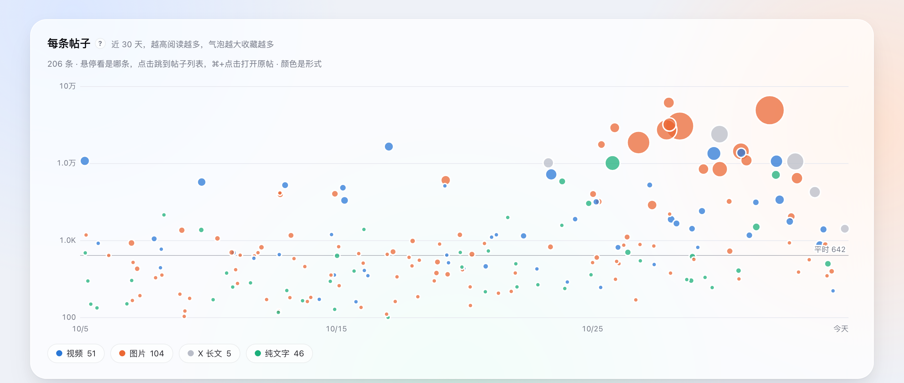

<div align="center">


# Postglow · 账号复盘

**一个轻量的 Mac 小工具：每小时读一次你的 X 帖子，在本地告诉你<br>哪些帖子被看、什么时候发更好、粉丝是怎么涨的。**

不用登录 · 不用 API Key · 数据只在你的电脑上 · 开源免费

[](https://github.com/BTCUP99/postglow/releases/latest)
[](#安装)
[](#安装)
[](LICENSE)

[**下载最新版**](https://github.com/BTCUP99/postglow/releases/latest) · [一行命令安装](#安装) · [English](#english)

<br>

<picture>
  <source media="(prefers-color-scheme: dark)" srcset="docs/images/overview-dark.png">
  
</picture>

</div>

## 它能告诉你什么

<table>
<tr>
<td width="50%" valign="top">

<p><b>每条帖子</b><br>近 30 天每条帖子的阅读，气泡越大收藏越多，颜色是形式。悬停看是哪条，⌘+点击打开原帖。</p>
</td>
<td width="50%" valign="top">

<p><b>传播 × 收藏</b><br>哪些帖子既被看又被收藏，最值得照着再写；哪些被看得多却没人存，该加点干货。</p>
</td>
</tr>
<tr>
<td colspan="2">

<p><b>发帖时段 · 怎么发</b><br>几点发、星期几发、视频还是图片、原创还是引用、写多长，各自比你平时的帖子好多少。帖子太少的组显示为淡色，不作结论。</p>
</td>
</tr>
</table>

还有：**概览**（本周阅读和上周比、粉丝 / 关注 / 发帖数的变化）、**粉丝**（每天一个点，以及哪些帖子发出后粉丝涨得多）、**发后多久见分晓**（发出 1 / 6 / 24 小时拿到 3 天阅读的几成）。每个板块旁边都有 **?**，鼠标停上去就会解释它在算什么。

## 安装

**一行命令（推荐）**：打开「终端」，粘贴这一行，回车。会下载最新版、装进「应用程序」并直接打开，不会弹任何安全提示。

```sh
curl -fsSL https://raw.githubusercontent.com/BTCUP99/postglow/main/install.sh | bash
```

**或者手动下载**：在 [Releases](https://github.com/BTCUP99/postglow/releases/latest) 下载 `Postglow_x.y.z_universal.dmg`，打开后照窗口里的三步做：

1. 把 Postglow 拖进「应用程序」。
2. 双击打开，macOS 会提示「已损坏，无法打开」：点「完成」（**不要**点「移到废纸篓」）。
3. 打开「系统设置 → 隐私与安全性」，拉到最下面点「仍要打开」，输入一次密码。以后就能正常打开了。

<details>
<summary><b>为什么会提示「已损坏」？安全吗？</b></summary>
<br>

文件并没有损坏，也不是病毒。macOS 会拦下所有没有经过 Apple 付费开发者认证和公证（每年 99 美元）的应用，并显示这句吓人的提示。Postglow 是免费的开源小工具，暂时没有做这一步。

- 全部代码就在这个仓库里，任何人都可以查看；安装包由 GitHub Actions 从公开代码自动构建。
- 它不需要登录 X，不读取密码或私信，只通过 FxTwitter 读取公开帖子；数据只存在你自己的电脑上。
- 用一行命令安装，或者以后在应用里更新，都不会出现这个提示。

</details>

**更新**：Postglow 会自动检查新版本，有更新时顶部出现提示，点「立即更新」，几秒完成、数据保留。已经装了旧版本也不用卸载，新版直接替换即可。

## 轻量

它平时待在屏幕顶部的菜单栏里，每小时读一次，其余时间什么也不做。在一台 Apple 芯片 Mac 上实测：

| | |
|---|---|
| **安装大小** | 下载约 5 MB，安装后 12 MB |
| **CPU** | 空闲时 0%，每小时读取时忙几秒 |
| **内存** | 约 180 MB：Postglow 本身约 30 MB，其余是 macOS 自带的网页引擎在显示页面，相当于浏览器的一个标签页 |
| **网络** | 每个账号每小时约 250 KB，一天约 6 MB |
| **磁盘** | 每个账号的数据通常不到 1 MB（只保留近 180 天、最多 3000 条） |

没有后台服务、没有服务器、没有统计上报；退出后不留任何常驻进程。

## 使用

1. 输入你的 X 用户名，第一次会回看约一个月（几十秒），之后每小时自动读一次。
2. 可以勾选 **登录 Mac 时自动启动**：开机后在菜单栏静默运行，不弹窗口，重启也不漏读。
3. 关闭窗口时，第一次会问你「留在菜单栏继续读取」还是「彻底退出」。要彻底退出，点菜单栏图标 → 退出，或按 ⌘Q。
4. 右上角 **?** 是完整的使用说明。

帖子满 72 小时才进入大部分统计，粉丝曲线每天一个点，所以开着用几天会越来越准。

## 隐私与数据

- **数据从哪来**：通过开源项目 [FxTwitter](https://github.com/FxEmbed/FxEmbed) 的公开接口读取公开帖子和资料，不需要登录 X，也不需要 API Key。除了 FxTwitter，不连接任何地方。
- **存在哪里**：只在你的电脑上。每个账号一个文件，`~/Library/Application Support/app.postglow.desktop/accounts/<用户名>.json`；当前账号和配色在同目录的 `prefs.json`。
- **多个账号**：点「换账号」最多可以保存 10 个账号，点一下切换。所有账号都在后台每小时各读一次，一个接一个地读；同一个账号在内存里只有一份，页面和后台读取改的是同一份数据，所以不会互相覆盖。写文件先写临时文件再替换，读到一半断电也不会留下半个文件。
- **删除**：在「换账号」里点账号旁的 ×，再点「确认删除」，只删那一个账号的文件。

<details>
<summary><b>数字怎么算</b></summary>
<br>

- **平时** = 近 30 天满 72 小时的原创和引用帖子的阅读中位数（至少 8 条）。页面上的「1.8×」都是「是平时的 1.8 倍」。
- 帖子只和同龄帖子比：满 72 小时的和「平时」比，更新的和其他帖子在 1 / 6 / 24 小时按时记下的读数比。
- 一组不到 10 条（按小时不到 5 条）显示为淡色，不作结论。
- 时间按电脑的本地时区。
- **涨粉从哪来**（估算）：每小时记一次粉丝数和每条新帖的阅读。先估出不发帖时粉丝的自然增减，再把每小时多出来的涨粉按各条帖子那一小时新增的阅读分配，只算发出后 72 小时内。X 不公开谁从哪条帖子来，所以它适合比较「哪类内容更带粉」，不是精确数字；单条帖子只列估算至少 3 个的。记满 48 小时后开始显示。

</details>

## 限制

- FxTwitter 是第三方服务，接口变动或不可用时读取会失败（会在顶部显示，15 分钟后重试）。
- 电脑睡眠或应用退出期间不会读取，错过的时间点会标为「不按时」，不参与对比。
- 目前只做了 macOS。

## English

**Postglow** is a small, open-source Mac app that reads your public X posts once an hour and shows, on your own machine, which posts got read, what hour and form work for you, how fast views arrive and where followers came from. No login, no API key, no server.

- **Install**: `curl -fsSL https://raw.githubusercontent.com/BTCUP99/postglow/main/install.sh | bash`, or download the `.dmg` from [Releases](https://github.com/BTCUP99/postglow/releases/latest). The app is not notarized by Apple (that needs a paid developer account), so for a browser download macOS says it "is damaged": it isn't. Click Done (not Move to Trash), then System Settings → Privacy & Security → Open Anyway, once.
- **Updates** install in place from inside the app (signed with Postglow's own updater key, data kept).
- **Lightweight**: idle CPU 0%, about 180 MB of memory (30 MB of its own, the rest is macOS's WebKit drawing the page), about 250 KB of network per account per hour, under 1 MB of data per account.
- **Data** comes from the open [FxTwitter](https://github.com/FxEmbed/FxEmbed) API and stays on your Mac: one file per account under `~/Library/Application Support/app.postglow.desktop/accounts/`. Up to 10 accounts, all read hourly, one at a time, so they never overwrite each other.
- The UI is in Chinese; every card has a **?** that explains it.

## 开发 · Develop

```sh
npm install
npm test          # the numbers (Node's test runner)
npm run dev       # the app, live
npm run build     # .app and .dmg in src-tauri/target/release/bundle
```

Built with [Tauri 2](https://tauri.app). The page is plain HTML / CSS / JavaScript in `src/`: `collect.js` reads and stores, `review.js` computes every number, `app.js` draws it, `help.js` holds the help text. The Rust side (`src-tauri/src/lib.rs`) keeps the window, the menu-bar icon, the per-account files, start at login and updates.

Release rules, the changelog and `scripts/release.sh`: [docs/MAINTAINING.md](docs/MAINTAINING.md).

## License

[MIT](LICENSE)
